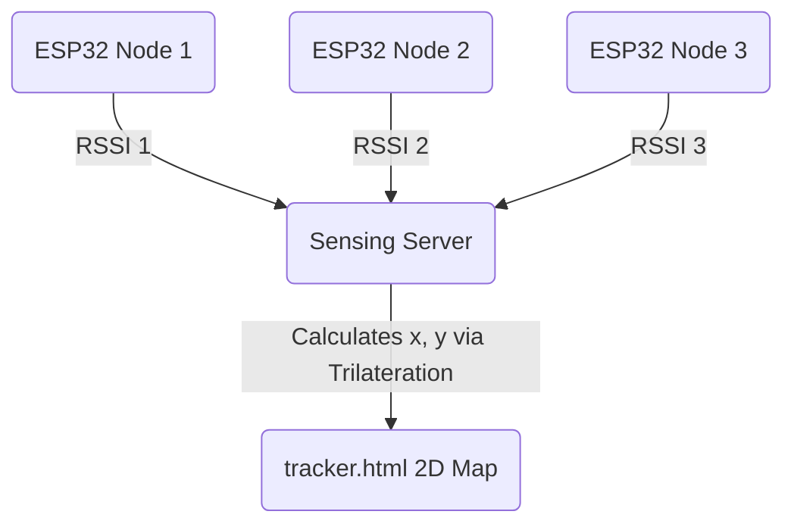

# RuView Room Presence Tracker: System Guide

This guide details the architecture, backend API schema, running instructions, and future 2D trilateration requirements for the mobile-friendly **RuView Room Presence Tracker** application.

---

## 1. System Overview

The tracker is composed of:
1. **Sensing Server (Backend)**: A Rust application (`wifi-densepose-sensing-server` crate) that processes raw WiFi Channel State Information (CSI) from ESP32 nodes and broadcasts high-level presence, activity, and vital signs data over a WebSocket stream.
2. **Dashboard UI (Frontend)**: A self-contained, mobile-first Web interface (`ui/tracker.html`) built with vanilla HTML/CSS/JS. It features a dark-themed glassmorphism aesthetic, a dynamic radial radar visualization, and an auto-reconnecting WebSocket client with a local simulation demo mode.

---

## 2. Backend API Schema

The sensing server runs a WebSocket server at `/ws/sensing`. It broadcasts real-time telemetry updates as JSON packets. The client supports two schemas, depending on whether data comes from the server-side heuristic/ML engine or directly from ESP32 edge firmware.

### Schema A: `sensing_update` (Core Backend Engine)

Sent by the main Rust classification engine.

```json
{
  "type": "sensing_update",
  "timestamp": 1783616602.911,
  "source": "esp32",
  "classification": {
    "presence": true,
    "motion_level": "present_still", // Options: "absent", "present_still", "present_moving", "active"
    "confidence": 0.945
  },
  "features": {
    "mean_rssi": -45.2, // Signal strength in dBm
    "motion_band_power": 0.0277, // Activity energy indicator
    "variance": 0.0277
  },
  "vital_signs": {
    "heart_rate_bpm": 78.4,
    "breathing_rate_bpm": 13.6
  }
}
```

### Schema B: `edge_vitals` (Direct ESP32 Edge Updates)

Sent by lightweight edge nodes compiling DSP directly on the micro-controller.

```json
{
  "msg_type": "edge_vitals",
  "presence": true,
  "motion": false,
  "presence_score": 90.0,
  "rssi": -48,
  "motion_energy": 0.015,
  "heartrate_bpm": 72.0,
  "breathing_rate_bpm": 14.2
}
```

---

## 3. Running Instructions

### Prerequisite: Submodule Setup
Since the project relies on several custom DSP and neural networking submodules, make sure git submodules are checked out first:
```bash
git submodule update --init --recursive
```

### Running the Backend Server

#### Option 1: Simulated Mode (No Hardware Needed)
To run the server locally generating simulated movement patterns:
```bash
cargo run -p wifi-densepose-sensing-server -- --source simulated --http-port 3000 --bind-addr 0.0.0.0
```

#### Option 2: ESP32 Hardware Mode
Ensure your ESP32 dev board is flashed with the RuView CSI emitter firmware and connected. Then run:
```bash
cargo run -p wifi-densepose-sensing-server -- --source esp32 --http-port 3000 --bind-addr 0.0.0.0
```

### Opening the Frontend UI
1. Navigate to the `ui` folder.
2. Open `tracker.html` directly in any web browser (`file:///path/to/tracker.html`) or serve it using your preferred lightweight HTTP server:
   ```bash
   npx serve ui
   ```
3. If using the real backend, the dashboard will connect automatically to `ws://localhost:3000/ws/sensing`.
4. If testing without a running backend, click the **Settings Gear** at the top right, turn **Demo Simulation Mode** to **ON**, and click **Save & Connect**.

---

## 4. Extending to 2D Trilateration

Currently, the UI maps a single-node setup where only the radial distance is estimated based on the Received Signal Strength Indicator (RSSI). To calculate coordinates $(x, y)$ of a person in a 2D plane, the system must be extended to support at least **three (3) ESP32 sensor nodes**.



### Step 1: Physical Placement
Place 3 ESP32 nodes in known coordinates within the room:
* **Node 1**: Origin $(0, 0)$
* **Node 2**: Along the X-axis $(U, 0)$
* **Node 3**: At coordinates $(V, W)$

### Step 2: Distance Estimation from RSSI
For each node $i \in \{1, 2, 3\}$, convert the Received Signal Strength ($RSSI_i$) to a distance estimate ($d_i$) using the **Log-Distance Path Loss Model**:

$$RSSI_i = RSSI_0 - 10 \cdot n \cdot \log_{10}(d_i)$$

Solving for $d_i$:

$$d_i = 10^{\frac{RSSI_0 - RSSI_i}{10 \cdot n}}$$

* $RSSI_0$: Reference signal strength measured at 1 meter (typically between $-35$ and $-45$ dBm).
* $n$: Path loss exponent, depending on obstacles and room characteristics (typically $2.0$ in open space, up to $3.5$ in cluttered indoor environments).

### Step 3: Trilateration Mathematical Formula
Given the coordinates of the three nodes $(x_1, y_1)$, $(x_2, y_2)$, and $(x_3, y_3)$, and the calculated distances $d_1, d_2, d_3$, the target coordinate $(x, y)$ lies at the intersection of the three circles:

$$1) \quad (x - x_1)^2 + (y - y_1)^2 = d_1^2$$
$$2) \quad (x - x_2)^2 + (y - y_2)^2 = d_2^2$$
$$3) \quad (x - x_3)^2 + (y - y_3)^2 = d_3^2$$

By positioning Node 1 at $(0, 0)$ and Node 2 at $(d_x, 0)$, the equations linearize and yield the analytical solutions:

$$x = \frac{d_1^2 - d_2^2 + d_x^2}{2 \cdot d_x}$$

$$y = \frac{d_1^2 - d_3^2 + x_3^2 + y_3^2 - 2 \cdot x \cdot x_3}{2 \cdot y_3}$$

### Step 4: Practical DSP Considerations
1. **Multipath Mitigation**: Indoor RSSI fluctuates heavily due to reflections. Before feeding RSSI values into the trilateration equations, apply a **Kalman Filter** or a **moving median filter** on the incoming RSSI stream to smooth noise.
2. **Visualizing in Frontend**: Modify the circular radar canvas in `tracker.html` to render a 2D bounding grid representing the room dimensions (e.g., 6m x 6m). Place the three nodes statically on the canvas grid and plot the dynamic coordinate $(x, y)$ as a glowing presence marker.
